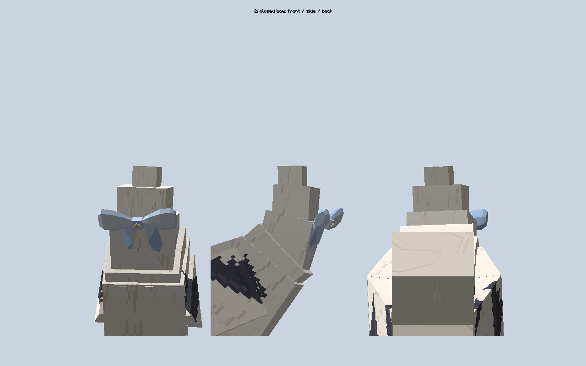

# 2i 尾巴蝴蝶结闭合

万象担架 1.6.0 尾巴蝴蝶结闭合修复（2026-10-19，当前交付）
正式文件：D:/AI/useless_stretcher-1.21.1-1.6.0.jar；12,550,415 字节。
SHA256：1BEE8C93DAF8678C0BE6ABA5E6057BDD86FA3C8F48E2FA9F56A659C6C1245204。
包内版本 1.21.1-1.6.0、协议 21，客户端与服务端同时更新，无需配置或重置存档。

- 补齐尾巴蝴蝶结双环两端的封口，垂带补齐背面和侧边；环周共用顶点并修正镜像面的朝向，保留原有比例、颜色与摆动。
- 完整 26 依赖真实客户端 12:44:33 验证 250 条非退化网格边均由两张面共用；尾根、960 时刻尾巴、粒子/眨眼、1200 次手部同步、100 次双持换手、144 组伞柄检查通过。12:44:52 总检查通过，近景正侧后视已查看。
- 普通无测试参数构建和构建包/根包双审计通过：247 生产源码、427 class、137 资源，测试/禁止条目 0。GuideME 内容沿用此前通过版本，此次没有重跑全部服务端或完整 ATM10。
- 旧包已核验归档 D:/AI/jar归档/20261019-before-two-i-closed-bow/；原源码/文档在 D:/AI/archive/1.6.0-before-two-i-closed-bow-20261019/。根目录只保留一个本项目 JAR，其它项目文件和历史未跟踪目录保留。
- 两 TXT 与交接同步 D:/AI，预览 D:/AI/2i-蝴蝶结闭合-20261019.png。源码沿用授权同步 GitHub main，不创建 Release/标签，待实测。
证据：verification/1.6.0-two-i-closed-bow-20261019.md。

实际日志：`run-20261019-tail-closed-bow-client.log`，普通构建 `build-20261019-tail-closed-bow.log`，双审计 `jar-20261019-closed-bow-final-audit.json` 和 `jar-20261019-closed-bow-delivered-audit.json`。依赖沿用 skin-tail-fixture-20261019.json 的 26 JAR，已逐项比对实际测试目录哈希一致。第三方 GuideME 图标、索引和材质警告原样保留。

