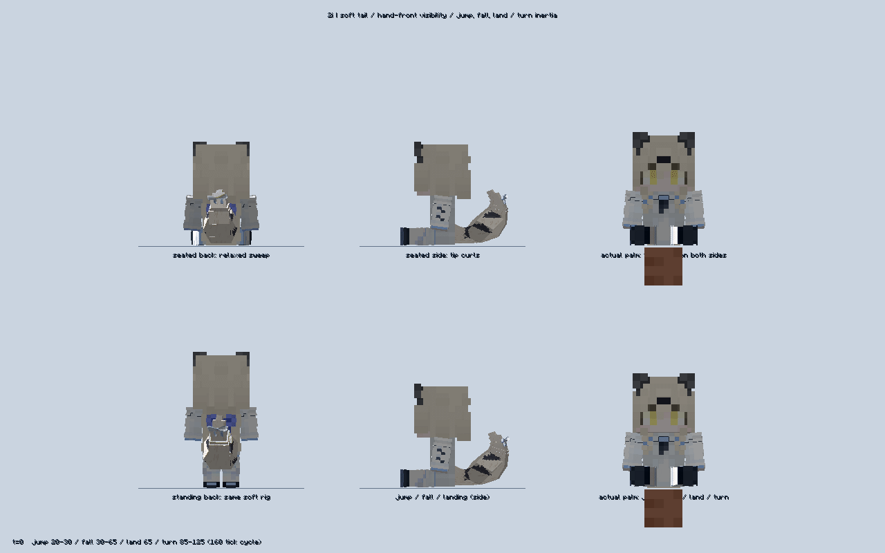
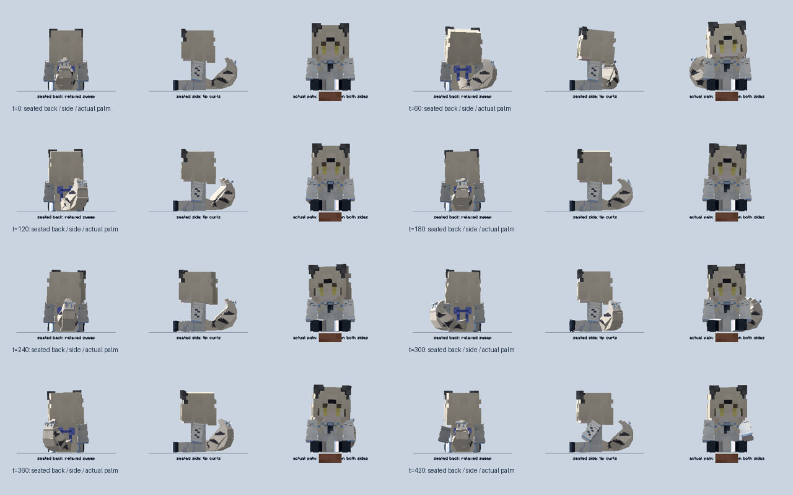
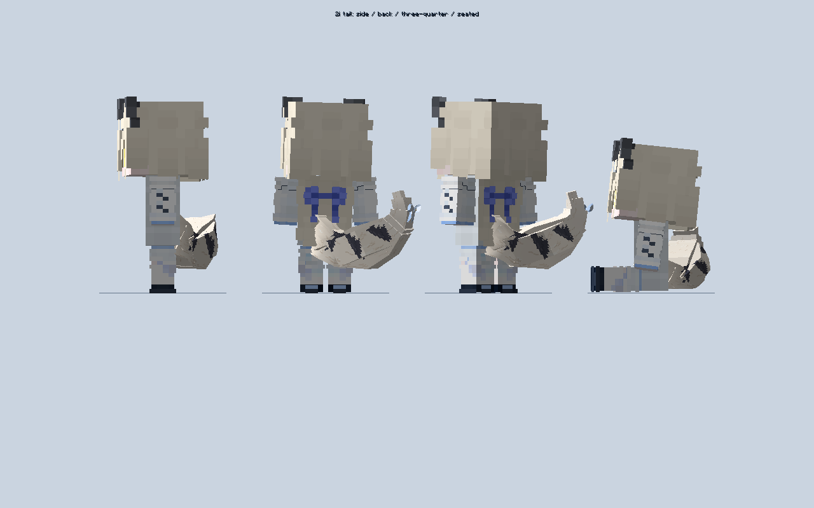

# 2i 柔软尾巴、毛绒纹理与尾根连接

本轮替代 `5173028` 的尾巴外观，保留 2i 新皮肤及已有玩法。正式文件：`D:/AI/useless_stretcher-1.21.1-1.6.0.jar`，12,549,829 字节，SHA256 `E19F57007DC65C43AC24C331EEF8F7A3EBF0C62EA7B426A6E45F3E12A1836CBA`。包内版本 `1.21.1-1.6.0`、协议 21。

- 酒狐几何保留原轮廓，宽面细分后按七段骨骼混合变形，中段不再整块僵硬旋转。左右扫尾交替并留有放松间隔，叠加舒展、卷尖和轻颤。尾根嵌入衣服后侧，根部权重固定后逐渐过渡到可动尾段，接触地面时仅下缘柔和压缩，不整体平移尾根，也不拉长尾巴。
- 独立尾部弹簧采样垂直速度、加速度、侧向运动与转身，产生起跳延迟、下坠上扬、落地回弹和转身滞后；不将新尾巴弹簧施加到玩家手臂。每载体每客户端 tick 仅采样一次，同载体两手/头戴复用；模型不保存跨物品累积物理状态，没有新增服务器扫描或网络包。
- 奶白底色增加方向性像素毛束、暖色底绒和碎边深蓝灰三角斑纹。浅蓝蝴蝶结改为浅厚度折叠双环、细结心、金色菱形饰点与燕尾垂带，随尾尖滞后轻晃。没有分发上游酒狐皮肤，原几何署名和 CC BY-NC-SA 4.0 许可仍随包保留。
- 统一实体、物品、手持、头戴、Curios、摆件和 UI 的尾巴。物品渲染在同一帧共用一次动画时钟，实际掌心 fixture 可指定时刻，未改玩家原有持握/换手变换。

## 实际验证

最终日志 `run-20261019-tail-contact-client.log`：12:11:35 新皮肤、真实粒子、眨眼、尾根、960 时刻双向摆动/连续性、跳跃/下落/转身/收敛、支撑面和模型复位检查通过；1200 次空闲同步、100 次双持换手与 144 组雨伞姿态通过。12:11:54 `2I SKIN TAIL CHECKS PASSED`。96 帧连续截图位于 `build/story-tail-contact-20261019/screenshots`。

左右尾尖 X 范围 -7.603 至 +7.654 模型像素，960 时刻平均 +0.031，最大单 tick 尾尖位移 0.219；不再固定偏左。2000 次本机姿态计算平均 10.125 微秒/次，此数字仅是局部姿态 CPU 采样，不含 GPU 绘制，不是所有硬件性能保证。

完整外部依赖仍为 26 JAR，版本和哈希沿用 `skin-tail-fixture-20261019.json`，测试目录复制后逐项校验一致；没有启动缺依赖实例。原有第三方 GuideME 图标/索引和材质警告保留。未重跑结构、全部剧情或强杀服务端，不扩展为完整 ATM10 认证。

`run-20261019-tail-lively-guide.log` 于 12:13:11 记录 `GUIDE CHECKS PASSED`（九页、四物品入口）。普通无测试参数构建 `build-20261019-tail-lively-final.log` 成功。构建/交付双审计逐项匹配 247 生产源码、427 class、137 资源，86 JSON/MCMeta；测试/第三方禁止条目 0，新图 SHA256 不变，旧皮肤 PNG 哈希匹配 0。

## 连续画面

## 中间结果与可恢复文件

- `build-20261019-lively-tail-compile.log` 是不存在的 compileStoryTestJava 任务失败；`run-20261019-tail-lively-final-client.log` 是 fixture 使用了不存在的 DefaultPlayerSkin 方法的编译失败，已修正，不算通过。
- `run-20261019-tail-lively-client.log`、`...final2-client.log`、`...delivery-client.log` 是连接修正前的通过轮，不代替最终轮。
- `run-20261019-tail-attached-client.log` 的落下支撑面断言失败；`...attached-final-client.log` 数值通过，但截图发现根部权重过小导致避地抬升拉长尾巴，已舍弃该方案。最终改为下缘柔和接触，并增加尾长断言；不把前一轮错误截图作为成品。
- 原源码/纹理/文档备份：`D:/AI/archive/1.6.0-before-two-i-lively-tail-20261019/`。旧根包 SHA256 `563BDD21...` 复制并核验后归档至 `D:/AI/jar归档/20261019-before-two-i-lively-tail/`。根目录只保留一个本项目 JAR，其它项目文件保留。
- 两 TXT、交接与根目录精简说明同步；GuideME 无换皮肤教程或隐藏装备介绍。按既有授权提交/推送 main，不创建 Release 或标签，等待用户实测。
