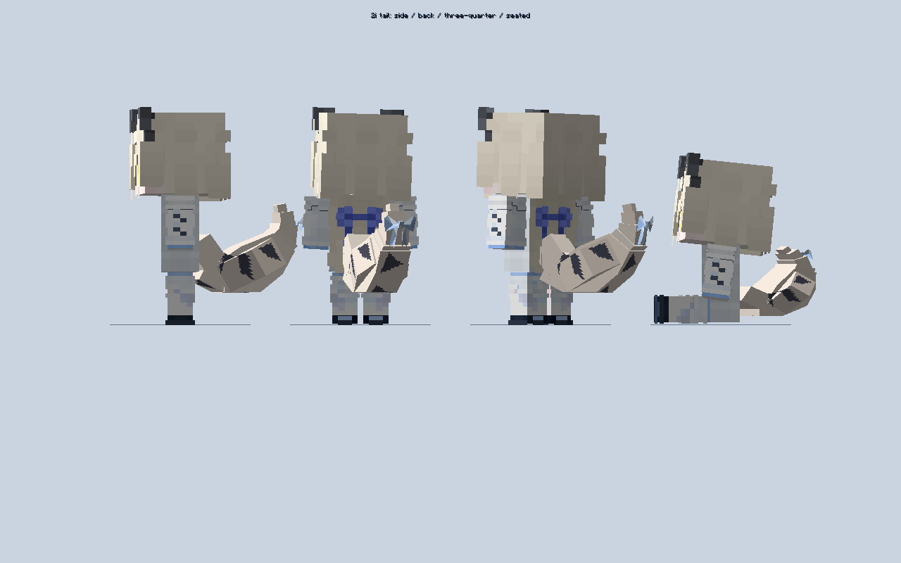
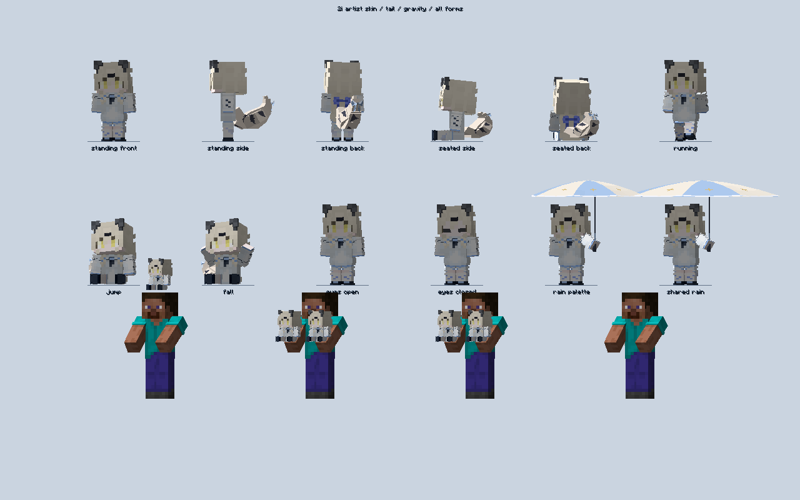

# 2i 新皮肤、酒狐尾根与坐姿翘尾验证

万象担架 1.6.0 新皮肤与尾巴（2026-10-19，当前最新）
正式文件：D:/AI/useless_stretcher-1.21.1-1.6.0.jar；12,544,582 字节。
SHA256：563BDD21C50D345FB4B6B0387291666A45B1CCDCFBA6444178DB6795D964645E。
版本 1.21.1-1.6.0，网络协议 21，客户端与服务端同时更新。

1. 全形态统一替换为玩偶文件夹中的 2i 新皮肤，实体、物品、掌心、头戴、Curios、摆件、互动预览以及物品/挖掘粒子共用新外观。新皮肤逐字节与原 PNG 一致，包内旧皮肤 PNG 哈希匹配为 0；动态眨眼适配新金色眼睛，眼皮使用奶粉肤色与深灰眼线，雨伞改为奶白浅蓝。
2. 大尾巴按车万女仆现代酒狐的原始几何与尾根改造，使用连贯毛层、奶白底色、深灰三角纹和浅蓝蝴蝶结。站姿保留饱满弯曲，坐姿单独向上翘起并检查整条尾巴和蝴蝶结的支撑面间隙；双环蝴蝶结有折痕、结心与 V 形垂带。实体和玩偶形态保持同一套模型。
3. 七段尾巴有轻摆、奔跑相位延迟、跳跃/下落惯性。仅客户端计算，复用现有携带速度采样，没有新增服务器全局扫描或网络包；几何与 UV 一次加载，边界按方块角点计算并缓存。静止手臂稳定、双持互换的原动作保留。
4. 完整 26 个外部依赖真实客户端 11:34:55 通过新皮肤、4096 像素真实物品/方块粒子、金色眼睛闭合、尾巴运动与坐姿避让、1200 次空闲同步和 100 次双持换手、144 组伞柄姿态检查；11:34:58 总检查通过。11:33:58 GuideME 九页编译/渲染与四入口通过。普通 build 与构建包/根包双重审计通过：247 源码、427 class、137 资源，测试/禁止项 0。
5. 尾巴几何改造自 TouhouLittleMaid 酒狐，原提交 8a3ac5e9eacf0c6d63adf8832949f3ce81484fe6；模型资产遵守 CC BY-NC-SA 4.0，来源与完整许可随 JAR 保留。未打包酒狐身体、皮肤或动画文件。GuideME 仅补充外观和动作说明，没有换皮肤教程或隐藏装备说明。

旧正式包可恢复归档：D:/AI/jar归档/20261019-before-two-i-skin-tail/。本轮只回归所列外观和交互，不代表重新认证全 ATM10 或全部剧情。源码沿用授权同步 GitHub main，不创建标签或 Release，等用户实测。详细证据：verification/1.6.0-two-i-skin-tail-20261019.md。

最终图：

原始日志：`run-20261019-skin-tail-winefox-root-client.log`、`run-20261019-skin-tail-guide.log`、`build-20261019-skin-tail-final.log`。中间 bow-client 角度断言失败已保留，最终检查尾尖实际位移与支撑面。第三方 GuideME 图标、Mixin 可选类和材质警告继续存在；不能描述为全依赖无警告。
