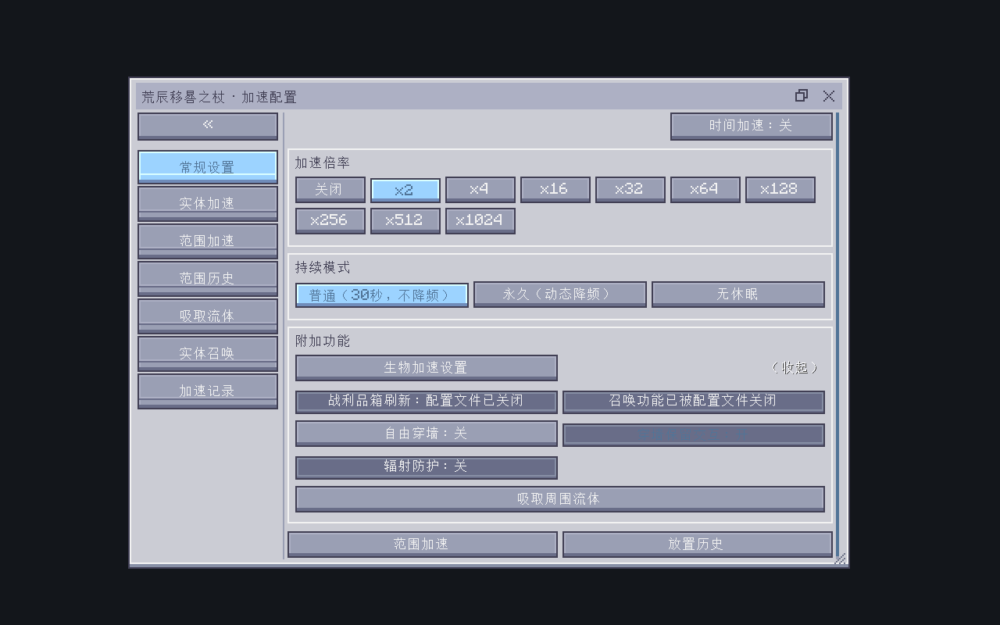
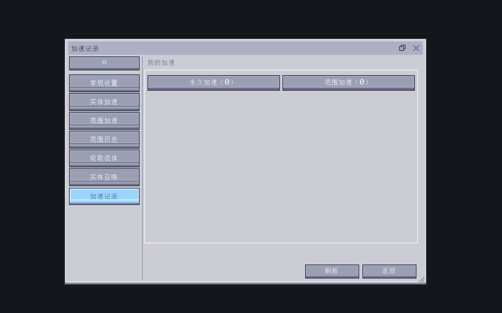
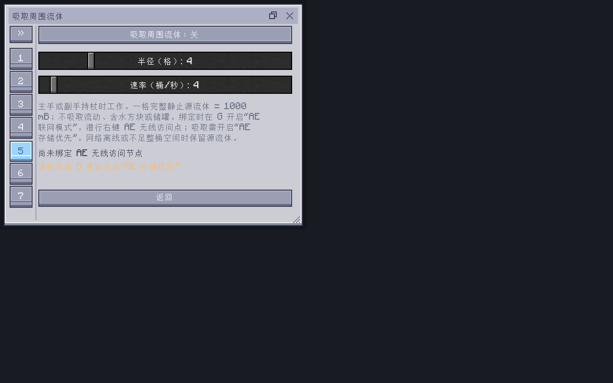

# 1.6.1 担架直接装入与手杖统一窗口

日期：2026-10-23。版本 `1.21.1-1.6.1`，协议 22，实际运行无用之物 2.4.6、AE2 19.2.17。只同步 main，不修改移植分支、Release 或标签。

## 设备接入

担架进入原生样板槽，小合金炉与多方块 core 的 `getPatternStacks` 在原生重建时展开共享库；同库 UUID 在一个设备中只展开一次。GUI、Shift 点击和 AE 终端各自的校验入口均已接入。旧右键投送保留。

物品新增源维度到既有 CUSTOM_DATA；旧 UUID-only 物品搜索服务器已存在的维度 SavedData，不强制加载区块。缺失源维度返回空库，避免误用本维度库。仓库分页、删除、修剪及去重同样按源维度处理。库快照按修订共享，变更通过弱引用通知已装载 provider 标脏，实际重建仍由本体执行。

被动仓每个物理担架槽保持一个本体任务，按原生槽倍率和间隔轮询库。一次选择最多 32 项，解码 LRU 最多 64 项，配方重载与库变更失效；材料选择仅模拟 AE 库存并在本地保留预演账目，真正扣料、执行、退款和任务存盘仍由本体处理。游标附加到设备 NBT。没有增加虚拟物理槽或宣称一槽无限并发。

## 窗口

所有手杖功能页共用一个 FloatingWindow，包含个人加速记录与历史范围编辑；世界回收器独立入口保持其原窗口。侧栏、内容和滚动事件隔离；标签会话保留搜索，进入或返回时重新读取手杖设置，延迟个人历史响应不会把玩家强制带回旧页面。

位置、尺寸、当前标签、侧栏及隐藏功能展开状态写入同一原子 JSON，兼容旧版无 preferences 字段。记忆不发游戏包。Ctrl+Tab / Ctrl+Shift+Tab 切换，Esc/叉关闭整窗。







## 实际验证

使用 `build/mod-fixture-occultism-full-1.224.4-20261019` 的 26 个外部 JAR，包含无用之物、AE2、Curios、Ars、Bees、Occultism、JDT/JDTE、AE2LT 及其前置。不是完整 ATM10/KubeJS，神化在 fixture 中缺席，仅额外渲染其实际布局，不宣称验证了该模组功能。

- `installed-source-first-20261023.log`：09:32:51 总通过；真实 GUI/handler/Shift 点击/AE 终端插入，通电 AE 发布与索引，原生 input transaction / pushPattern 执行并回网，库变更刷新，被动仓一个槽生产两种产物，旧 UUID、跨维度、缺失维度和 NBT 检查。
- `installed-source-restart-20261023.log`：09:33:53 在搭建前检查上次真实设备槽位、库及游标恢复，09:34:13 总通过；被动轮询前取消已有原生任务再清测试库存，避免把上次产物当成本次结果。
- `installed-packaged-final-restart-20261023.log`：09:45:13 真实设备重启恢复，09:45:22 小炉与总成实际产出，09:45:33 被动及全部检查通过。诊断 JAR 保留最终生产包全部 686 条目原字节，仅追加三份 InstalledStretcherChecks class；身份见 `installed-packaged-final-entry-audit-20261023.json`。候选包的首次真实进程也通过并保留单独日志/审计，后续变化仅涉及 UI。
- `staff-tabs-guide-client-20261023.log`：09:43:58 九页 GuideME 编译/渲染和四个入口通过，09:44:05 `STAFF TABS UI CHECKS PASSED`。实际标签按钮和 Ctrl 切页、拖动缩放、重新从磁盘读取 JSON、展开恢复、搜索保留、返回按钮、窄视口和历史编辑滚动通过。已人工查看主页面、记录页及窄视口截图。
- `build-installed-staff-tabs-final-20261023.log` 是无测试参数普通构建；构建与交付包双审计确认版本/协议和全部生产类资源一致，测试项 0。

开发失败证据原样保留：`installed-mixin-development-failure-20261023.log` 的多目标 remappable shadow 被跳过，已修正并增加目标实例接口断言；`installed-legacy-development-failure-20261023.log` 的空维度字符串误判已修正。`staff-tabs-preview-development-failure-20261023.log` 是无游戏连接预览触发历史请求，已加连接判断。其余配方模具准备、预览适配及窄页无需滚动/无世界关闭返回标题画面的测试假设修正在 build 的独立失败日志中保留。第三方可选 Mixin、模型/动画、GuideME 预览配方占位和 Ars 赞助名单网络失败等日志没有删除，未影响本轮最终断言。

运行命令（JAVA_HOME 指向 Java 21，含点号的 Gradle 参数在 PowerShell 中加引号）：

```powershell
.\gradlew.bat '-PregressionTests' '-PinstalledPatternsOnly=true' `
  '-PcompatibilityModsDirectory=build/mod-fixture-occultism-full-1.224.4-20261019' `
  '-PregressionDirectory=build/regression-installed-stretcher-20261023' runRegression --console=plain
.\gradlew.bat '-PguideTests' '-PstaffTabsUi=true' `
  '-PguideModsDirectory=build/mod-fixture-occultism-full-1.224.4-20261019' `
  '-PguideDirectory=build/guide-staff-tabs-delivery-20261023' runGuidePreview --console=plain
.\gradlew.bat build --console=plain
```

## 最终交付

- `D:/AI/useless_stretcher-1.21.1-1.6.1.jar`，12,600,315 字节。
- SHA256：`9AFE6DEDF04BF11A5DB0D3C03BB4AE0C9E6573C49CE4B36C123603AA01ED856D`。
- 259 个生产源码对应类、447 class、137 资源、86 JSON/MCMeta，测试/第三方禁止条目 0。皮肤 SHA 和六章、图片、声音资源均保留，见双审计。
- 相对上轮细臂包，新增 14 条目、修改 30、删除 0，642 条目逐字节相同；129 个 2i/流体/Occultism 相关保护条目完全一致，完整列表见 `1.6.1-installed-staff-tabs-entry-diff-20261023.json`。
- 旧包经过 SHA 核对后可恢复归档到 `D:/AI/jar归档/20261023-before-installed-stretcher/`，根目录仅保留新项目包。两 TXT、交接和版本说明同步根目录，GuideME 三页已更新。历史未跟踪 `$dir/`、`$new/`、`net/` 保留。
