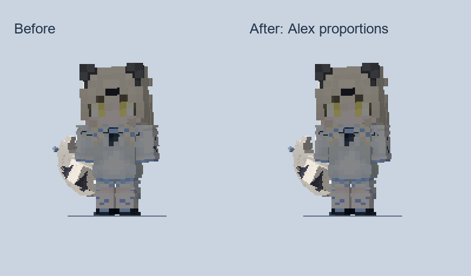
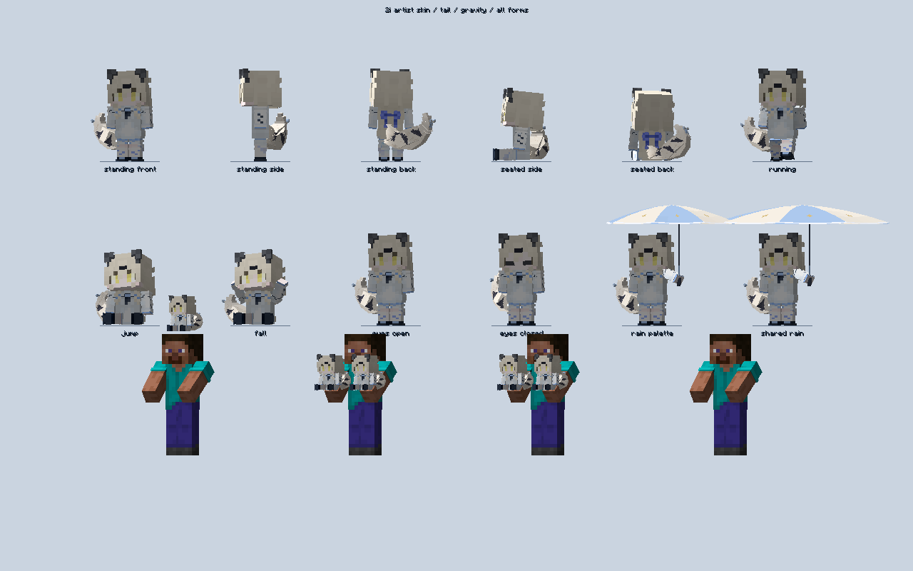

# 1.6.1 2i 细臂

按用户要求，将 2i 原有 Steve 式的手臂改为 Alex 式的 3:4 宽厚比例。版本仍为 `1.21.1-1.6.1`，网络协议保持 22。

## 实现与外观

- `TwoIDollRenderer.Model` 的手臂横向缩放从 0.75 改为 0.5625，宽度缩窄 25%；长度、厚度和肩部位置保持原值。袖层通过同一骨骼变换同步变细。
- 保留现有标准化皮肤 UV 及原始 PNG，没有裁掉贴图边缘，手掌与袖子仍完整。实体、物品、摆件、第一/第三人称手持、头戴、Curios 和互动面板使用同一模型。
- 细臂会改变掌心握点，握伞时右臂侧倾从 1.04 调为 1.14 弧度，伞继续从实际掌心变换计算位置。没有放宽伞柄/头部间距断言。
- 此次没有新增网络包、服务端定时任务或每刻扫描；只改客户端模型及 GuideME 的 2i 页面。

已人工查看以下实际渲染截图，检查细臂、袖子、手掌、撑伞及各形态：





对比左图来自 `build/story-tail-closed-bow-20261019` 的改前截图，右图来自本轮最终客户端，两图使用相同裁切和最近邻缩放。

## 实际验证

使用现有 `build/mod-fixture-occultism-full-1.224.4-20261019` 的 26 个外部 JAR，含 AE2、无用之物 2.4.6、Occultism 1.224.4、Ars、Bees、Curios、JDT/JDTE、AE2LT 及其前置。这是兼容 fixture，没有声称是完整 ATM10。

```powershell
.\gradlew.bat -PstoryTests -PskinTailOnly=true `
  -PstoryModsDirectory=build/mod-fixture-occultism-full-1.224.4-20261019 `
  -PstoryDirectory=build/story-slim-arms-20261021 runStoryPreview --console=plain
.\gradlew.bat build --console=plain
```

实际客户端日志冻结为 `run-slim-arms-client-20261021.log`：

- 18:34:00：`2I CLOSED BOW PASSED`、`2I LIVELY TAIL PASSED`、`2I NEW SKIN AND PARTICLE ATLAS PASSED`，包含原皮肤 SHA、重载后的眨眼颜色、4096 像素粒子映射、尾巴摆动和重力回弹。
- 18:34:00：`2I HAND STABILITY PASSED`，1200 次同步不触发空闲重装备，100 次双持交换仍有两手动画。
- 18:34:00：`2I UMBRELLA GRIP PASSED`，144 组真实烘焙姿态的握点、头/帽间距、伞面间距和伞杆封顶检查通过。
- 18:34:18：`2I SKIN TAIL CHECKS PASSED`，全部相关检查及动态截图完成后客户端正常退出。

首次细臂尝试的肩位/伞角导致伞杆离头帽太近；恢复原肩位后，1.08 弧度在极限姿态仍不足，最终 1.14 通过。两次失败日志冻结为 `slim-arms-umbrella-clearance-failure-20261021.log`、`slim-arms-umbrella-clearance-refinement-20261021.log`。测试断言未改，未把 Gradle 的零退出误当成测试通过。

日志含第三方模型、GeckoLib 动画、GuideME 图标和索引警告，保留原文。没有宣称日志无警告，也没有重跑此次未改动的所有服务端、剧情或 ATM10 回归；流体等原有证据仍见 `1.6.1-staff-fluid-20261021.md`。

## 最终包与交付

- 路径：`D:/AI/useless_stretcher-1.21.1-1.6.1.jar`；12,570,783 字节。
- SHA256：`E7C6138E9CC743F971C9BE3F6B4B6B6FC7CF0EF722441659A3565D047DBDBE06`。
- 无测试参数构建成功：`build-slim-arms-1.6.1-20261021.log`。
- 构建包/根目录交付包双审计：`jar-slim-arms-1.6.1-{build,delivery}-20261021-audit.json`。249 个生产源码对应类、433 个 class、137 个资源匹配，86 个 JSON/MCMeta 可解析，测试/第三方禁止项 0；六章剧情、17 图片、7 声音、新皮肤和尾巴资源保留。
- `1.6.1-slim-arms-entry-diff-20261021.json` 确认相较上一流体包，仅 `TwoIDollRenderer$Model.class` 和 `two_i.md` 改变，569 个其余文件条目逐字节一致，无新增/删除。流体收集、协议、粒子贴图等均未改动。
- 旧包已核对 SHA 并可恢复归档到 `D:/AI/jar归档/20261021-before-slim-arms-1.6.1/`；归档清单 `slim-arms-delivery-archive-20261021.json`。根目录只保留新的项目 JAR。
- 两 TXT、交接及版本说明同步 D:/AI，改前文档在 `D:/AI/archive/1.6.1-before-slim-arms-20261021/`；预览图 `D:/AI/2i-细臂对比-20261021.png`。

源码按既有授权同步 `main`；不改动 `1.20.1` 移植分支、不创建或更新 Release、不移动标签。历史未跟踪 `$dir/`、`$new/`、`net/` 保留。
