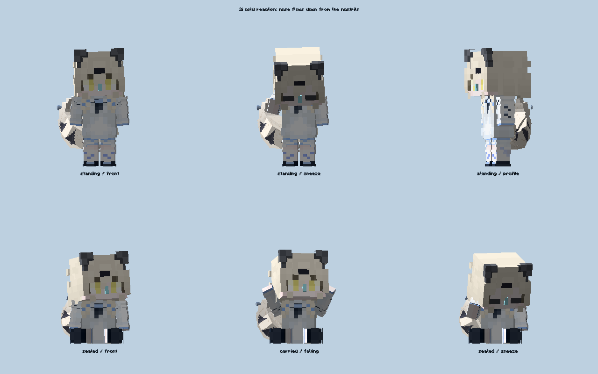
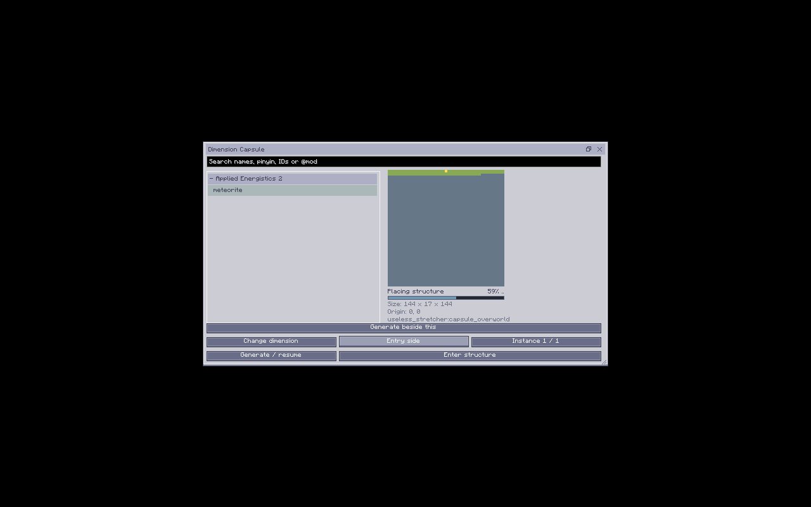

# 1.6.2 胶囊地图、AE2 陨石与 2i 鼻涕修复

日期：2026-10-23。基线 `fd6ba96`，版本 `1.21.1-1.6.2`，协议保持 22。使用 Java 21、NeoForge 21.1.249、无用之物 2.4.6、AE2 19.2.17。

## 根因与处理

胶囊地图重复压入 body 裁剪。FloatingScreen 结束时只弹出一层，留下的 GL scissor 限制下一帧 framebuffer clear，地图出现后造成全屏闪烁。地图局部裁剪与 pose 现在用 try/finally 成对恢复，不再重复压入 body；同一窗口复用 DynamicTexture，仅像素变化时上传，关闭或切换时释放。

AE2 MeteoriteStructurePiece 的原生 BB 只有中心 Y 一层；原生 placer 实际写入中心下 8 格至上 7 格，另含石英芽。原生 move 又只移动 BB，不移动 settings.pos 的绝对中心。结合原生 19.2.17 字节码核对后，新增 CapsulePieceGeometry：通过 AE2 自身的 NBT 构造保留半径、变体、fallout 等原生参数，搬移绝对中心并扩展实际高度包络。原生 XZ 范围保持不变，其余结构继续走原生 move。清理、收尾和基岩都使用完整高度。

保存 geometry_version。旧版未完成陨石计划按保存的 sourceOffset 修正，保留原生计划后清理未发布半成品、重置放置游标并继续生成；迁移本身不会给玩家发布一个半成品。**已完成实例不自动覆盖或补发内容**，玩家改建和已领内容保留。旧半截陨石请使用“生成相邻实例”，新实例采用修复后的原生生成。

2i 鼻涕原先从头部原点缩放负 Y geometry，伸长时滑向额头。现在以鼻部 pivot 为固定点，从局部 Y=0 向正 Y（下巴）伸长。实体、摆件、手持、头戴和饰品使用同一模型。

## 实际复现与最终包检查

测试 fixture 包含 26 个外部 JAR，含 Curios、Ars、Bees、Occultism 1.224.4、JDT/JDTE、AE2LT 及前置；不是完整 ATM10/KubeJS。不据此宣称任意整合包或第三方回调零卡顿。

- `client-capsule-map-old-jar-20261023.log`：14:50:29 原交付 1.6.1 JAR 第 0 帧真实复现 unmatched scissor rectangle。诊断副本保留该旧包所有生产条目原字节。
- `server-capsule-meteorite-before-20261023.log`：14:45:47 旧版真实计划的内部中心不在搬移后 BB，Y 仅单层。原世界和旧计划保留，没有覆盖失败证据。
- `client-capsule-map-nose-packaged-1.6.2-20261023.log`：14:57:59 `CAPSULE MAP RENDER CHECKS PASSED`。360 次像素更新、720 次真实 render，覆盖 planning/cleaning/placing/bedrock/trimming/ready；每次结束裁剪栈归零、GL_SCISSOR_TEST 关闭，嵌套父裁剪保留一层；纹理保持同一实例。地图压力测试使用合成像素，截图不冒充真实陨石地图。
- 同一客户端 14:58:00 `2I NOSE CHECKS PASSED`：240 组站立/坐姿/携带冷天姿态，鼻部固定且向下；1200 次手部同步、100 次双持换手和 144 组实际撑伞姿态通过。六视图截图已人工查看。
- `server-capsule-meteorite-packaged-1.6.2-20261023.log`：14:58:33 负坐标、三轴移动、垂直抬升与原生 NBT round trip 通过，同刻 `CAPSULE GEOMETRY MIGRATED`。15:00:03 实例 0 上部 564/下部 991、神秘方块 1、石英 14；15:01:29 相邻实例 1 上部 569/下部 991、神秘方块 1、石英 13，总检查通过。中心分别 `(2000010,55,2000000)`、`(2000170,55,2000000)`，包络 Y47..63、基岩 Y46。迁移使用从旧失败运行复制的世界，没有新建计划掩盖旧数据。
- `server-capsule-meteorite-restart-1.6.2-20261023.log`：15:02:25 另一个真实 Java 进程读取同一世界，实例 0、1 在第 1、2 刻检查通过，无重新放置。两次 body_sha256、plan_hash 完全相同，见 `capsule-restart-content-comparison-1.6.2-20261023.json`。
- `client-guide-1.6.2-20261023.log`：15:03:08 九页 GuideME 编译渲染及四个物品入口通过；胶囊页截图已查看。标题页预览无世界时的配方占位警告保留。
- `client-capsule-journey-1.6.2-20261023.log`：15:08:12 实际 Curios 佩戴和渲染通过；15:08:51 原生前哨站生成、服务端目录、@模组多词搜索、真实阶段进度与地图、旋转、小窗口及 2i 气泡和跟随光标预览通过；15:08:56 两次通过实际网络进入同一实例、两次持胶囊返回原位置通过。实际生成地图及进入截图已查看。此项是源代码集成运行，前述地图压力及 AE2 陨石使用最终包诊断副本运行。
- `server-surface-focused-1.6.2-20261023.log`：15:13:53 沙漠神殿 8429 个非空气方块、4 箱/4 战利品、9 TNT、6 考古方块；15:14:04 丛林神庙 1221 方块、2 箱/4 战利品容器及 2 发射器；15:14:11 沼泽小屋 197 方块，总检查通过。三者均验证基岩完整、SavedData 序列化、后台停止/恢复不换计划，以及就绪通知只发一次和旧记录不补发通知。测试使用本次新建普通源世界，沙漠神殿搜索了 618 次才匹配，规划约 64 秒；这不是固定的生成时间或普遍速度保证。

最终包测试由 `run-capsule-packaged-check.py` 执行：诊断副本只追加对应测试 class，逐条断言所有生产条目与交付 JAR 字节相同；移除 MOD_CLASSES/FML_MOD_CLASSES，classpath 排除 build/classes，由 JAR 实际加载生产代码。身份见 `client-capsule-production-1.6.2-20261023.json` 和 `server-capsule-production-1.6.2-20261023.json`。交付包没有这些测试。





## 交付身份及保留内容

- 文件：`D:/AI/useless_stretcher-1.21.1-1.6.2.jar`，12,602,932 字节。
- SHA256：`B2668B6F1D817F9B64976C4276D132AB1A03BF3D53FB34265B7EB7331A8FE17F`。
- 根目录交付包再次审计通过，见 `jar-1.6.2-capsule-delivery-audit-20261023.json`。旧 1.6.1 包先核对 SHA 后移入 `D:/AI/jar归档/20261023-before-1.6.2-capsule-repair/`，根目录仅保留此 1.6.2 项目包。
- 无测试参数普通构建日志：`build-capsule-1.6.2-final-20261023.log`；构建审计：`jar-1.6.2-capsule-build-audit-20261023.json`。260 个生产源码对应类、448 class、137 资源、86 JSON/MCMeta，测试和第三方禁止条目 0。
- 与上一交付 1.6.1 比较，新增 1、修改 13、删除 0，572 个文件条目逐字节一致。变化只涉及胶囊修复、鼻涕模型、版本和三页指南，见 `1.6.2-capsule-entry-diff-20261023.json`；皮肤、尾巴、故事、流体、Occultism、担架直接装入及手杖侧栏生产条目均保留。
- 从 1.6.0/1.6.1 升级无需重置存档，客户端与服务端一起替换。main 同步；1.20.1 移植分支、Release 和标签不变。

## 开发过程证据

`run-capsule-repair-before-20261023.log` 保留同时开启 regression/story 源集产生重复资源的失败；后来两种运行分开执行。初次候选包元数据未更新，审计拒绝后已同时修正 gradle.properties 和 neoforge.mods.toml，最终版本审计通过。

`client-capsule-curios-sync-development-failure-20261023.log` 和 `client-capsule-curios-capability-development-failure-20261023.log` 保留额外往返回归前置 Curios 检查过早读取客户端 capability 的失败。第一次只等待 ring 定义仍会失败，后来同时等待 capability 与 ring 同步。只修正测试的同步等待，仍保留超时、身份和实际渲染断言；未改变产品的 Curios 行为。第三方缺失注册项、可选 Mixin、模型、配方和网络相关警告/错误原样保留，不以 Gradle 退出 0 代替明确通过标记。

`server-surface-entity-preflight-development-failure-20261023.log` 保留旧 surfaceOnly 入口先执行 EntityFeatureChecks，在 authorized reclaim 后立即检查远程索引未清除的失败。本轮将 surfaceOnly 限定为 SurfaceCapsuleChecks；实体与星空检查仍保留在完整/专用回归入口，未修改该实体生产逻辑，也不宣称本轮完整实体服务端回归通过。地表结构的原生内容、战利品、考古、后台恢复及通知断言全部保留。

复现入口（含点号 Gradle 参数需在 PowerShell 中完整加引号）：

```powershell
.\gradlew.bat '-PstoryTests' '-PcapsuleRepairOnly=true' `
  '-PstoryModsDirectory=build/mod-fixture-occultism-full-1.224.4-20261019' `
  '-PstoryDirectory=build/new-capsule-client-check' `
  -I verification/capture-capsule-launch.init.gradle runStoryPreview --console=plain
# 用实际 Python 运行，--run 必须为新目录；不使用系统 Windows 应用执行别名。
python verification/run-capsule-packaged-check.py --mode client `
  --jar build/libs/useless_stretcher-1.21.1-1.6.2.jar `
  --run build/new-capsule-client-check `
  --fixture build/mod-fixture-occultism-full-1.224.4-20261019
.\gradlew.bat '-PregressionTests' '-PsurfaceOnly=true' `
  '-PcompatibilityModsDirectory=build/mod-fixture-occultism-full-1.224.4-20261019' `
  '-PregressionDirectory=build/new-surface-check' runRegression --console=plain
```

服务端 packaged 入口对应 `-PregressionTests -PcapsuleRepairOnly=true` 捕获，再使用脚本 `--mode server`；`--world-from` 使用旧版未完成计划世界，首次退出后同目录 `--restart` 开第二个进程。独立服务端目录需先同意 EULA 并准备 server.properties。regression 与 story 参数分开运行，避免重复加入资源源集。
