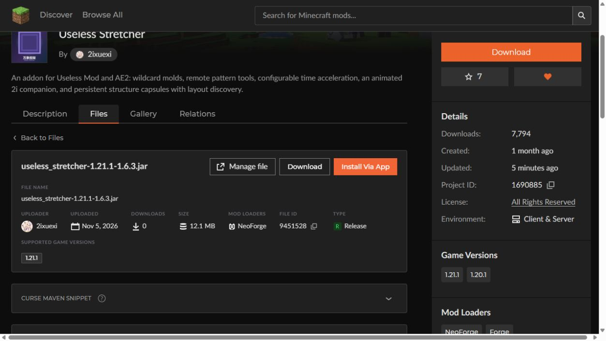

# 1.6.3 发布回执 — 2026-11-05

按用户授权，先更新 GitHub，再更新 CurseForge。正式文件和显示名均保持 `useless_stretcher-1.21.1-1.6.3.jar`。

- 生产源码：`2f1fe845343673512829cbf080117257b7958bec`；已原子推送 `main` 和 `feature/capsule-variants`。
- [GitHub Release v1.6.3](https://github.com/21i0/UselessStretcher/releases/tag/v1.6.3) 已正式发布，标签指向生产源码；三个附件大小及 API digest 均通过校验，JAR 正式下载链接 HTTP 200。
- [CurseForge 文件 9451528](https://www.curseforge.com/minecraft/mc-mods/useless-stretcher/files/9451528) 已上传并 **Approved**；公共页面提供下载，Release / Minecraft 1.21.1 / NeoForge / Java 21 / Client + Server。
- 已重开文件编辑页核对：Some-Useless-Things 和 AE2 必需；GuideME 和 Curios API 可选。
- 项目中英文说明已保存并在公共页生效，增加 1.6.3 兼容修复说明；保留功能清单、许可和独立 1.20.1 移植说明。未修改现有 Forge 文件。
- CF 实际匿名下载 HTTP 200，12,691,712 字节，与本地 JAR SHA256 完全相同：`00A10F69575B941C6A7545D28B43749362CB02FC9E30288ABC271520537B5BFC`。

本地成品：`D:/AI/useless_stretcher-1.21.1-1.6.3.jar`。仓库与 D:/AI 两份 TXT 和交接均补充最终发布状态。原主工作区未提交玩偶改动、1.20.1 分支与其它文件保留。

证据位于 [version-1.6.3-20261105](version-1.6.3-20261105/)：GitHub 回执、CF 回执、下载哈希、保存后的文件元数据、公开页面快照及截图。另复制到 `D:/AI/万象担架-CurseForge发布资料/20261105-1.6.3/`。

旧 CF 1.6.2 文件 9430671 的拒绝原因是与已删除的 9430416 重复；这是此前重命名重传的旧二进制。本轮为包含新兼容修复的 1.6.3，已通过审核。历史回执不改写为本轮状态。

本回执不扩大游戏验证范围，实际测试及限制见 [1.6.3-watchdog-compat-20261105.md](1.6.3-watchdog-compat-20261105.md)。实际游戏日志仍保留当时的 1.6.2 中间版本，1.6.3 生产 class 字节一致性审计另存。

